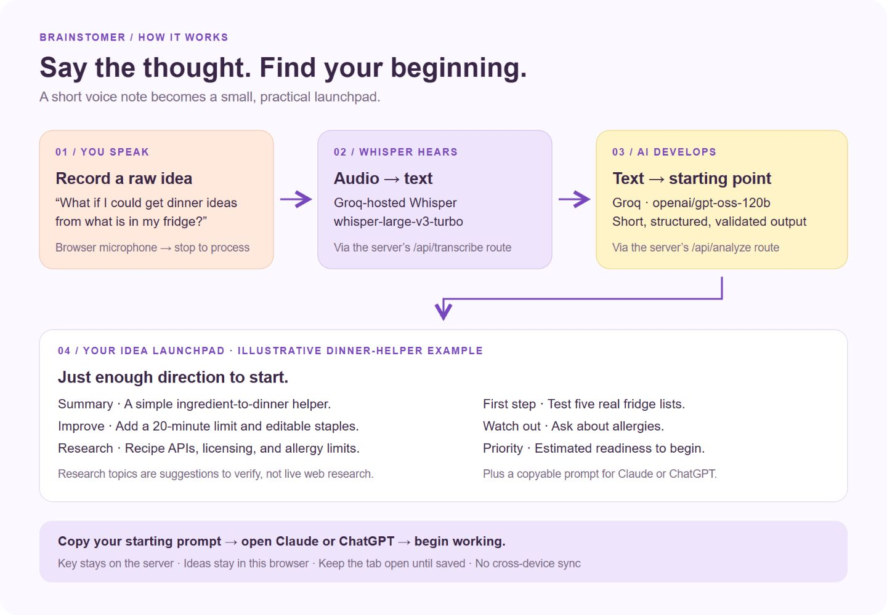

# Brainstomer

**Brainstomer helps you start at 0.005.** It sounds like a tiny head start. But if you’ve ever struggled to get a project from 0 to 1, you know how much it helps to sit down with a first step you can actually take.

You’re in the middle of a project when an idea pops up. It might solve a problem you’re working on, or it might be the start of something new. You jot it down in your notes app and get back to work. Later, you open the note and still have to figure out where to begin.

What if you could speak that thought into Brainstomer on your phone? When you sit down at your laptop, your starting point is ready. Save a thought as a new idea or add it to one you’re already working on. Brainstomer gives you:

- **A short summary** so you can remember what you meant.
- **Ways to improve the idea** and one pitfall to watch for.
- **Research suggestions** with search terms and a reason each topic matters.
- **One concrete first step** and a rough priority estimate to help you decide what to tackle.
- **A ready-to-use prompt** you can paste into Claude or ChatGPT to start working.

The **personal version** lets you record on your phone and pick up on your laptop when you sign in to the same workspace. The **public demo** lets you try the recording and AI workflow without an account and saves your ideas in the browser where you capture them.

**[Try the live demo](https://brainstomer-showcase-2bkh.vercel.app/)**

## A look inside


Tap **Record an idea**, speak, then tap stop. Whisper transcribes the audio automatically. Groq uses the text to generate your starting point.



Here’s what the result looks like for the built-in dinner helper example.


## What you can try

- Explore three built-in examples.
- Record a voice idea, upload an audio file, or write a thought.
- Add a follow-up thought to an existing idea and revisit its earlier starting points.
- Search your ideas, sort by priority, and track their status.
- Copy a prompt into Claude or ChatGPT, or export an idea as Markdown.

## How it works

1. **Capture.** Record, upload audio, or type your idea.
2. **Transcribe.** For audio, the server sends the recording to Groq-hosted Whisper through `/api/transcribe`. Typed ideas skip this step.
3. **Save.** Brainstomer stores the idea in your browser.
4. **Develop.** `/api/analyze` sends the text to Groq and validates the structured response.
5. **Start.** Open your idea, choose what to research, or copy the prompt into a fresh chat.

Research suggestions are starting points for your own searches. Priority reflects the AI’s estimate of clarity, feasibility, scope, and how easy the idea is to start.

The public demo saves ideas, transcripts, and version history in your browser. Each visitor has their own collection. Groq receives the audio or text it processes, and the application server discards uploaded audio after processing. Keep the page open until you see the save confirmation.

Recordings can run up to two minutes, and uploaded audio can be up to 4 MB. The demo keeps up to 100 ideas and five generated versions per idea, subject to browser storage capacity. If analysis fails after an idea is saved, you can retry it from the idea page.

## Run locally

Use Node.js 22.13 or newer.

```bash
npm ci
```

Copy `.env.example` to `.env.local` and set your Groq key.

```env
GROQ_API_KEY=your_groq_api_key
```

Keep `GROQ_API_KEY` server-side. Use a dedicated key if you plan to share the demo publicly. The built-in examples and typed idea capture work without a key.

```bash
npm run dev
```

Open [localhost:3000](http://localhost:3000). Restart the server after changing `.env.local`.

## Deploy to Vercel

1. Push the showcase source to a GitHub repository and import it into Vercel.
2. Select the **Next.js** framework preset.
3. In **Project Settings → Environment Variables**, add `GROQ_API_KEY` to the environments where you want live AI.
4. Deploy with the standard `npm run build` command. If you imported a parent repository that contains the showcase, set the **Root Directory** to `showcase`.

The app uses the Next.js App Router and Node.js route handlers for transcription and analysis.

## Public demo safeguards

- The Groq key stays on the server. Visitors can use live AI without entering their own key.
- The API limits request sizes, checks browser request origins, and validates AI responses.
- Each warm server instance allows up to eight AI requests per minute per IP and 20 per minute across visitors. A voice idea typically uses two requests. These counters apply independently to each instance.
- API responses use `Cache-Control: no-store`. The connection endpoint reports whether a key is configured.
- All visitors share the demo account’s Groq allowance. For a widely shared demo, apply a rate limit at the Vercel Firewall or use a shared limiter.

## Checks

```bash
npm test
npm run typecheck
npm run build
```

Tests cover browser storage, deletion, request limits, origin checks, throttling, and API responses using mocked Groq calls.

## Project layout

```text
app/                 Dashboard, recording dialog, and server API routes
lib/client-api.ts    Browser workflow and API calls
lib/local-store.ts   Idea storage and cleanup
lib/demo.ts          Built-in example ideas
lib/server.ts        Groq requests and server safeguards
public/              Bulb artwork and favicon
docs/                Screenshots and workflow diagram
tests/               Storage and API tests
```
