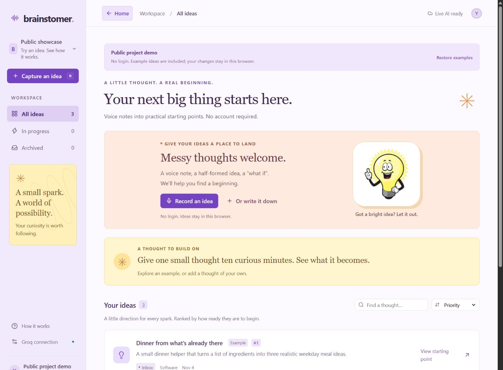
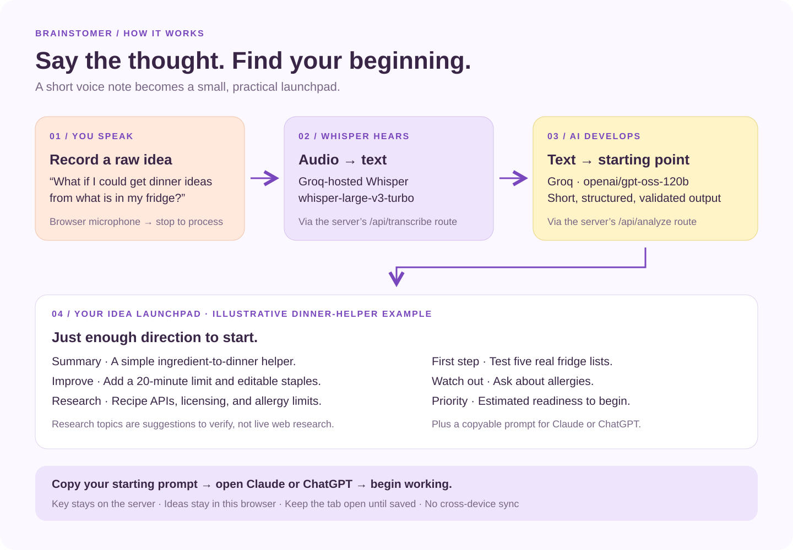
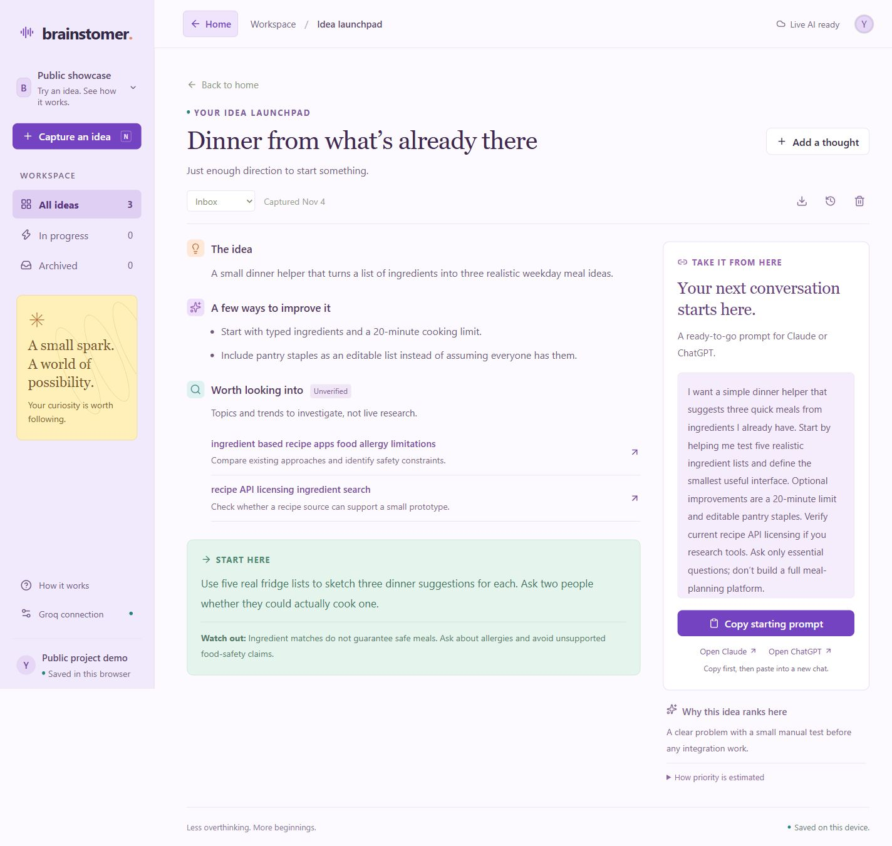

# Brainstomer

**The hardest part of a project is often getting from 0 to 1. Brainstomer helps you start at 0.05.**

You're working on a project when a thought pops up. Maybe it solves something you're stuck on. Maybe it's an idea for a completely different project. You could jot it down in your notes app, or you could say it out loud in Brainstomer and get back to what you were doing.

Save the thought as a new idea or add it to one you're already working on. Brainstomer turns your recording into a short starting point you can pick up when you're ready to work.

- **A clear summary** so you can remember what you meant.
- **Ways to improve it** and a pitfall to watch for.
- **Things to look up** with search suggestions and a reason each one matters.
- **One practical first step** and a rough priority estimate to help you decide what to tackle.
- **A prompt for Claude or ChatGPT** that carries your idea and its context into a fresh chat.

In the **personal version**, record on your phone or any device where you're signed in. When you're ready to sit down at your laptop, open the same workspace and pick up your starting point. In this **public demo**, you can try the recording and AI workflow without signing in. Your ideas stay in the browser where you captured them.

**[Try the live demo](https://brainstomer-showcase-2bkh.vercel.app/)**

## A look inside



Speak a rough thought, stop recording, and get a compact starting point. There is no transcript review step.



Here's what a starting point looks like for the built-in dinner helper example.



## What visitors can try

- Three clearly labelled example ideas and their short starting points, with no API setup required.
- Record a voice idea, upload audio, or write a thought.
- Groq-hosted Whisper transcription followed by a compact AI summary, improvements, research questions, and a first step.
- Copy a standalone prompt into Claude or ChatGPT, or export an idea as Markdown.
- Search, priority sorting, status changes, and the last five generated versions of each idea.
- Browser-local persistence. No accounts, database, or cross-device sync.

Live AI requires the project owner’s **dedicated showcase Groq key**. Visitors do not enter a key. Without that configuration, examples still work and typed ideas can be saved locally.

## Run locally

Use Node.js 22.13 or newer.

```bash
npm ci
```

Copy `.env.example` to `.env.local`, then add the key from the separate Groq account intended for this public demo:

```env
GROQ_API_KEY=your_public_demo_account_key
```

Never use `NEXT_PUBLIC_GROQ_API_KEY`. The key must remain server-side. A blank, ignored `.env.local` is already provided in the working copy for convenience; it is not included in Git or the distribution ZIP.

```bash
npm run dev
```

Open [localhost:3000](http://localhost:3000). Restart the server after changing the environment file.

## Publish to GitHub and Vercel

1. Create a GitHub repository and push **the contents of this folder**. Do not push the personal app or its archives.
2. In Vercel, import that repository and choose the **Next.js** framework preset.
3. Set `GROQ_API_KEY` in **Project Settings → Environment Variables**, using the separate public-demo account.
4. Deploy. The standard build command is `npm run build`; no custom output directory is needed.
5. If this folder is part of a larger repository instead, set Vercel’s **Root Directory** to `showcase`.

No database, OAuth provider, Cloudflare bindings, or Sites plugin is needed. This is a normal Next.js App Router application with Node.js route handlers, so do not configure it as a static export.

## How it works

```text
Browser recording / typed thought
             |
     /api/transcribe (Whisper, if audio)
             |
     Idea saved in browser localStorage
             |
     /api/analyze (Groq structured output)
             |
     Short starting point + copyable prompt
```

The server handles processing only. Ideas, transcripts, and version history are stored in that visitor’s browser, not a shared server database. Audio is not retained by the application server. Groq receives the audio/text used for inference. Clearing browser data removes saved ideas. Keep the page open until the saved confirmation; this edition has no background queue or cross-device handoff.

Audio recording is limited to two minutes and uploads to 4 MB to fit Vercel’s function request limits. Up to 100 ideas and five generated versions per idea are kept locally, subject to the browser’s storage capacity. A failed AI request preserves the saved idea for retry.

## Public-demo safeguards

- Dedicated server-only Groq key; no personal key, credentials, or database copied from the private edition.
- Bounded JSON/audio request bodies and validated AI responses.
- Same-origin browser requests, no CORS wildcard, and no raw AI HTML rendering.
- Best-effort throttles per warm server instance: 8 AI requests/minute per IP and 20/minute globally. One voice idea normally uses two requests. These are **not distributed limits**; cold starts and multiple regions have separate counters.
- Before promoting the demo widely, configure a Vercel Firewall rate-limit rule or shared limiter, and use account-level usage/spending controls. All visitors share the dedicated account’s allowance.
- API results use `Cache-Control: no-store`; the key is never returned by the connection endpoint.

Research suggestions and example reports are not live web research. The app does not verify current trends or claim that its estimated priority scores predict success.

## Checks

```bash
npm test
npm run typecheck
npm run build
```

The tests cover local-data persistence/deletion, corrupt-storage handling, payload limits, origin checks, throttling, and the AI routes using mocked Groq responses. Real inference needs your new key and is not exercised by the test suite.

## Project layout

```text
app/                 Dashboard, recording dialog, and Node.js API routes
lib/client-api.ts    Browser-local workflow and server processing calls
lib/local-store.ts   Local persistence and cleanup
lib/demo.ts          Clearly labelled fictional examples
lib/server.ts        Server key handling, limits, and Groq requests
public/              User-supplied bulb artwork and favicon
tests/               Storage and request-boundary checks
```

The mascot image was supplied for the original project and retained as part of its visual design. No personal recordings or ideas are included.
